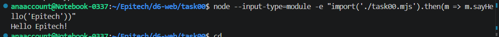
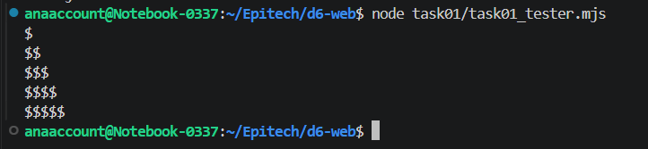
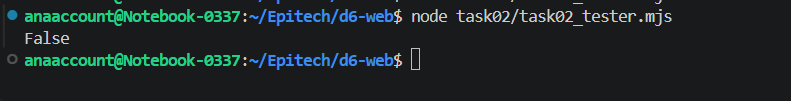
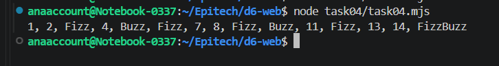
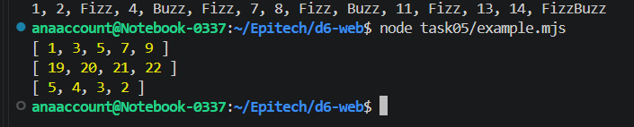

# d6-web

## task 00:

## task 01:

## task 02:

## task 03:

 *the fist command shows 1 because I forgot to include the mini "g" on the code.

## task 04:

## task 05:

## task 06:

## task 07:

